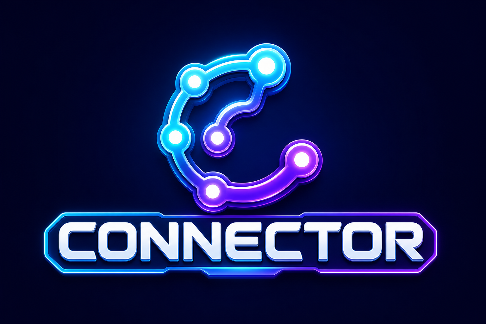

<p align="center"></p>

# Connector: a learning adventure for ages 4–6

[](https://github.com/tiwari-romil/Connector/actions/workflows/ci.yml)

Connector is a browser game that teaches early logic, maths and science to children who can't read yet. It reads every question aloud. Difficulty adapts to each child, and after two wrong tries the game explains the answer instead of letting the child guess.

I built it for a real player, a 5-year-old in Senior KG. The design notes, from the first review to the phased roadmap, are in [`docs/IMPROVEMENT_PLAN.md`](docs/IMPROVEMENT_PLAN.md).

## What's inside

| Game | What the child does | Under the hood |
|------|---------------------|----------------|
| 🧩 **Puzzle Adventure** | 12 islands of picture puzzles: patterns, odd one out, counting, sums, analogies, ordering, mazes and arrow "coding", shadows, mirror images, position words, balance scales and mini-Sudoku | Every puzzle is **generated** from a seed at one of 10 levels. Unit tests check that each one has exactly one right answer. |
| 🏆 **Olympiad prep** | 200 questions in 25 common junior-olympiad styles: practice by level or by type, plus eight timed 25-question mock papers with a review at the end | All pictures are SVG built in code (`app/olympiad/draw.ts`), so the question bank is plain data that tests can check |
| ➕ **Maths quizzes** | 70 levels climbing from picture sums within 5 to two-digit sums with tens and ones; hints show apples or rods and blocks | Wrong options are typical mistakes (off by one, tens mixed up), not random numbers |
| 🔬 **Science quizzes** | 50 spoken questions about the world around them | Answer order changes on every visit |
| 🔎 **Discovery missions** | With a grown-up: build numbers with tens and ones, and predict → observe → explain simple experiments (magnets, ice, shadows) | Interactive models plus a free-play "lab" |

### Design choices for a 5-year-old

- **No reading needed.** Every prompt is spoken using the browser's speech engine, with an Indian-English voice when one is available.
- **Think first.** Answers only become tappable after the question has been read out.
- **Adaptive difficulty.** Each island has a level from 1 to 10. Three first-try answers in a row move the level up; two misses on one puzzle move it down. About 70 % of puzzles are at the current level, 20 % one easier and 10 % one harder.
- **Fair rewards.** ⭐⭐⭐ first try, ⭐⭐ second try, ⭐ after help. A level's stars count only once, so replaying a solved level can't inflate the total.
- **Short sessions.** A game is 5 puzzles followed by a sticker. After three games the fox suggests a break.
- **Grown-up corner.** Press and hold to see per-skill levels and first-try rates. Holding is easy for an adult but hard for a child to trigger by accident.

## How this was built: AI-assisted engineering

I built Connector with AI coding agents (OpenAI Codex and Anthropic Claude) doing most of the typing. My part was the engineering judgement:

- **Product and learning design.** I defined the player, the age-appropriate skill progression, the reward and break rules, and what "too hard" looks like. I wrote these down as a phased plan ([`docs/IMPROVEMENT_PLAN.md`](docs/IMPROVEMENT_PLAN.md)) before any code was written.
- **Directing and reviewing.** I broke the work into phases, reviewed every change, and pushed back on generated content that was ambiguous or pitched at the wrong age. For example, some odd-one-out questions had two defensible answers.
- **Verification.** Generated code had to prove itself. The puzzle generators, question bank, save-file parsing and scoring rules are pure TypeScript with unit tests, and CI runs lint, type checks and tests on every push.
- **Play-testing.** The roadmap sets levels from watching the real player — where they ask for help, where they tap randomly, what they replay — rather than from guesses.

## Tech stack

- **React 19** with the Next.js App Router, built by vinext (Next.js on Vite) and deployable to **Cloudflare Workers**
- **TypeScript** in strict mode. The game logic (`app/puzzles/model.ts`, `app/quiz/content.ts`, `app/olympiad/bank.ts`, `app/discovery-model.ts`) has no React or browser dependencies, so tests can run it directly.
- **Web Speech API** for read-aloud and **Web Audio API** for synthesised sound effects and music (no audio files)
- **localStorage** for progress, with every save validated on load, so a damaged save resets cleanly instead of crashing the game
- Tests use Node's built-in `node:test`, plus a server-render smoke test against the production build

## Run it

Requires [Node.js](https://nodejs.org/) 22.13 or later.

```bash
git clone https://github.com/tiwari-romil/Connector.git
cd Connector
npm ci
npm run dev          # http://localhost:3000
```

To play on a phone or tablet on the same Wi-Fi, run `npm run play:lan`. Then open `http://<this computer's IP>:3100` on the device. On Windows, `scripts/start-lan-game.ps1` finds and prints that address for you.

<details>
<summary>Optional: a double-click launcher for Windows</summary>

`scripts/StartGame.cs` builds into a small `Start-Game.exe` that starts the game and opens the browser. Build it with the C# compiler that ships with Windows, then keep the .exe in the project folder:

```powershell
& "$env:WINDIR\Microsoft.NET\Framework64\v4.0.30319\csc.exe" /nologo /out:Start-Game.exe scripts\StartGame.cs
```
</details>

## Commands

```bash
npm run dev        # development server
npm run build      # production build
npm run start      # serve the production build locally
npm run lint       # ESLint
npm run typecheck  # TypeScript
npm test           # build, then run all tests
npm run deploy     # deploy to Cloudflare Workers (needs `npx wrangler login` first)
```

## Project structure

```
app/
  page.tsx              home: game switcher, sound, quiz progress
  WelcomeScreen.tsx     start screen and the player's name
  puzzles/              Puzzle Adventure: model.ts (generators, adaptive levels, saves) + UI
  olympiad/             Olympiad prep: bank.ts (200 questions), draw.ts (SVG kit) + UI
  quiz/                 Maths and Science level quizzes: content.ts (levels, scoring) + UI
  DiscoveryMissions.tsx Discovery missions UI (logic in discovery-model.ts)
  speech.ts, audio.ts   read-aloud and sound helpers
tests/                  unit tests for every model + a server-render smoke test
worker/index.ts         Cloudflare Worker entry
scripts/                local-network launcher
```

## Controls

- Tap or click an answer. On a keyboard, press `1`–`4` (or `A`–`D` in Olympiad prep), then `Enter` for the next question.
- 🔊 in the top bar turns all sound and speech on or off. **Hear it again** repeats the question.
- Progress is saved in the browser on that device.
